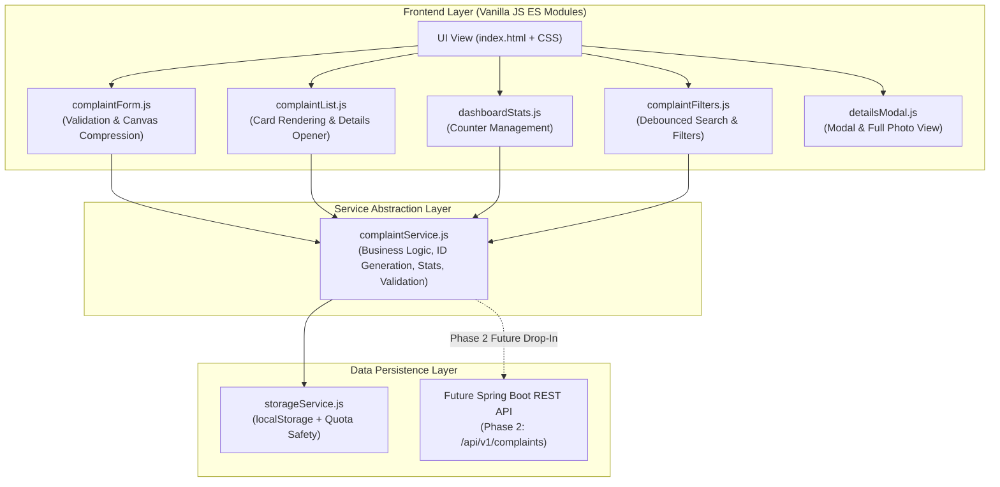
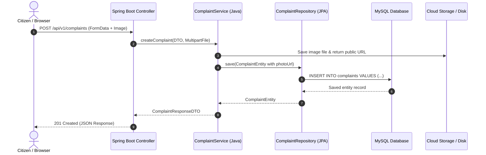

# CivicConnect — System Architecture Documentation (Phase 1 & Roadmap)

## 1. Overview
**CivicConnect** is a Smart Public Issue Reporting & Resolution System designed to bridge the communication gap between citizens and municipal municipal departments.

Phase 1 focuses on building a robust, responsive, and future-expandable **Citizen Dashboard** using standard Web technologies (HTML5, CSS3, Modern JavaScript ES6+) with an abstracted **Service Layer Pattern**.

---

## 2. High-Level Architectural Diagram

---

## 3. Layer Separation & Design Principles

### 3.1 UI / Presentation Layer
- **Responsibility:** DOM event listeners, user input capture, rendering cards and counter updates.
- **Rule:** The UI does **not** directly interact with `localStorage` or make network calls. It only requests data and reports user intent to `complaintService`.

### 3.2 Module Components
- `complaintForm.js`: Manages the Report Complaint modal. Performs client-side image compression via HTML5 `<canvas>` (resizing to max 800px at 75% JPEG quality) to prevent storage overflows.
- `complaintList.js`: Dynamically renders responsive complaint cards with category icons, status pills, and handles card selection.
- `dashboardStats.js`: Keeps the 4 main metrics (Total, Pending, In Progress, Resolved) in sync.
- `complaintFilters.js`: Provides live debounced search across ID, Title, Category, and Location along with dropdown filters.
- `detailsModal.js`: Displays comprehensive grievance information and photographic evidence.

### 3.3 Service Layer Pattern (`complaintService.js`)
- **Key Advantage for Viva & Presentation:**
  Instead of tightly coupling UI components with `localStorage.getItem()` or `localStorage.setItem()`, all business rules (validation, ID format `CC-2026-XXXX`, timestamp generation, category matching, and counter calculations) reside strictly in `complaintService.js`.
- In Phase 2, when moving to Java Spring Boot, the internal calls in `complaintService.js` will simply be updated to `fetch('http://localhost:8080/api/v1/complaints')` without changing any UI code.

### 3.4 Data Storage Layer (`storageService.js`)
- Interfaces directly with browser `localStorage`.
- Safely initializes default seed data (4 diverse municipal complaints) on first launch.
- Implements `try / catch` error handling for `QuotaExceededError` so the dashboard never crashes even on storage quota limits.
- Provides a reset feature to restore clean demo sample data.

---

## 4. Client-Side Image Resizing & Storage Optimization

Browser `localStorage` typically enforces a strict **5MB per origin** quota limit. Raw smartphone cameras produce photos between 3MB and 12MB. Storing an uncompressed image directly would instantly crash the browser's storage engine.

### Solution Workflow:
1. User selects a photo (or takes a photo via mobile camera).
2. `complaintForm.js` checks MIME type (`image/jpeg`, `image/png`, `image/webp`) and file size ceiling (2MB max upload).
3. The image is drawn onto an in-memory `<canvas>` element scaled down to a maximum dimension of 800px while maintaining the original aspect ratio.
4. `canvas.toDataURL('image/jpeg', 0.75)` compresses the image into a lightweight Base64 string (~60KB - 120KB).
5. The string is saved as part of the complaint record, safely fitting comfortably within `localStorage`.

---

## 5. Phase 2 Backend Migration Roadmap

